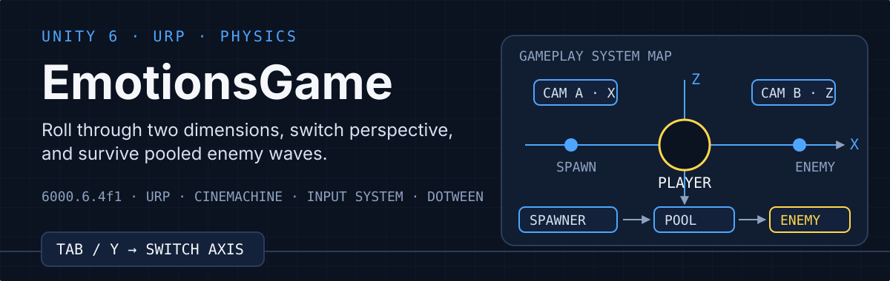
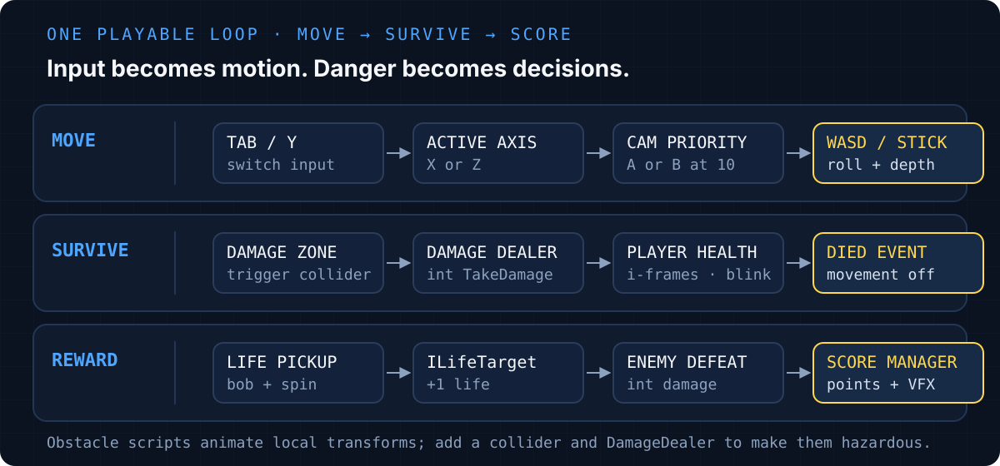
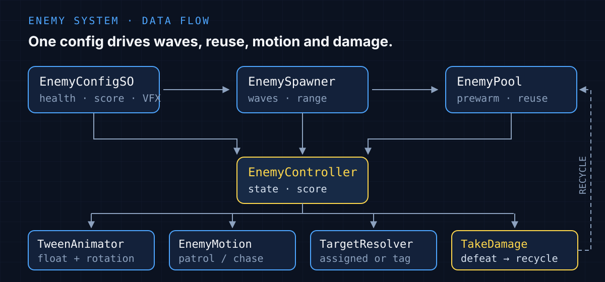

<p align="center">
  
</p>

# EmotionsGame
[](https://deepwiki.com/therabbithd/EmotionsGame)


A playable Unity 6 game where a smiley sphere rolls across two orthogonal dimensions, switches perspective with Cinemachine, and survives pooled enemy waves, tweened obstacles and a lives-and-score loop. It now includes a complete game shell: menu, HUD, pause, settings, credits, end screens, persistent progress and three distinct levels.

**Stack:** Unity `6000.6.4f1` · URP `17.6.0` · Cinemachine `6.6.0` · Input System `1.20.0` · uGUI · DOTween

**Audio note:** music is intentionally not included. The user adds the soundtrack manually; only procedural SFX are generated for UI, pickups, damage, shots, dashes and win/lose feedback.

## See the loop

<p align="center">
  
</p>

`Assets/Scenes/MainMenu.unity` boots the game shell. `GameFlowController` loads `Level1`, `Level2` and `Level3`, creates the uGUI HUD, wires pause/settings/credits/end screens and writes progress to a JSON save. Enemies come from configuration and return to a pool; hazards damage targets through interfaces; each animated object owns its tweens so recycling one system does not kill another.

## Play it

1. Open this folder as a project in Unity `6000.6.4f1`.
2. Open `Assets/Scenes/MainMenu.unity`.
3. Press **Play**.
4. Use **Nueva partida** or **Continuar**, then clear each level's enemy goal before the timer runs out.

| Action | Keyboard | Gamepad |
| :--- | :--- | :--- |
| Move | `WASD` or arrow keys | Left stick |
| Switch dimension | `Tab` | Button North (`Y` / `Triangle`) |
| Shoot | `J` or left mouse button | Right trigger |
| Dash | `K` | Left shoulder |
| Pause / resume | `Esc` | Start |
| Confirm | `Enter` | Button South (`A` / `Cross`) |
| Back / cancel | `Backspace` | Button East (`B` / `Circle`) |

The three levels are `Assets/Scenes/Level1.unity` (6 defeats), `Level2.unity` (10 defeats, 95 s) and `Level3.unity` (14 defeats, 120 s). Progress and SFX volume persist in `Application.persistentDataPath/emotions_game_save.json`; the HUD shows lives, score, ammo, objective and time.

## How the player moves

`Assets/Scripts/RollingSphere.cs` drives a `Rigidbody` with `ContinuousDynamic` collision detection.

- **Dimension A (X axis):** horizontal input moves on X; `camDimensionA` gets priority `10`.
- **Dimension B (Z axis):** horizontal input moves on Z; `camDimensionB` gets priority `10`.
- `W` / `S` still adds depth movement inside the active dimension.
- `rotationSpeed` controls the visual turn toward `0°` or `90°`.
- `maxSpeed` and `acceleration` control target velocity and how fast it is reached.
- `SetMovementEnabled(false)` stops input and zeroes velocity; `PlayerHealth` uses it when the player dies.

## Enemy system

<p align="center">
  
</p>

The enemy system is data-driven and pooled. `EnemySpawner` reads `EnemyConfigSO` assets, asks `EnemyPool` for instances, and initializes each `EnemyController`. Animation, movement, target lookup and health stay in separate components. Both damage paths return defeated enemies to the pool; the integer path also awards score and can spawn death feedback.

### Drop-in setup

1. Drag `Assets/EnemySystem/EnemySystem.prefab` into the scene.
2. Tag the player `Player`, or assign `assignedTarget` on the spawner.
3. Add one or more `EnemyConfigSO` assets to the spawner's `enemyTypes`.
4. Optionally fill `spawnPoints`; otherwise waves use `spawnRadius` around the spawner.
5. Press **Play**. Waves activate when the target is inside `activationDistance`.

### Components

| File | Job |
| :--- | :--- |
| `EnemyConfigSO.cs` | Serialized tuning for health, score, effect, DOTween motion, patrol/chase and proximity activation. Validates values in `OnValidate`. |
| `EnemySpawner.cs` | Coroutine-based waves. Grows wave size by `waveIncrement`, shortens `spawnInterval` per wave, and stops its routine on disable/destroy. |
| `EnemyPool.cs` | Prewarm, get and return. Tracks active enemies in a `HashSet` so instances cannot be returned twice. |
| `EnemyController.cs` | Legacy float-damage path, target proximity, tween and motion shutdown, and pool return. |
| `EnemyHealth.cs` | Integer damage, single-death guard, score reward, optional VFX/audio and clean reset on reuse. |
| `EnemyTweenAnimator.cs` | Owns the float and rotation `Tween`s; kills them when disabled, destroyed or reused. |
| `EnemyMotion.cs` | Patrol/chase state machine using one active coroutine at a time. |
| `TargetResolver.cs` | Uses an assigned target, a cached target, or `GameObject.FindGameObjectWithTag`. |
| `IDamageable.cs` | Two contracts: `EmotionsGame.Enemies` uses `float`, `EmotionsGame.Health` uses `int`. |

<details>
<summary>Main tuning values</summary>

- **Combat:** `maxHealth`, `score`, `destructionEffect`.
- **DOTween:** `floatAmplitude`, `floatDuration`, `floatDelay`, `floatEase`; `rotationAxis`, `rotationDuration`, `rotationDelay`, `rotationEase`, `fullTurn`.
- **Movement:** `patrolRadius`, `patrolSpeed`, `chaseSpeed`, `minPause`, `maxPause`, `waypointReachDistance`.
- **Activation:** `detectionRadius`, `releaseRadiusMultiplier`, `activationBehavior` (`Chase` or `HoldPosition`).
- **Waves:** `initialDelay`, `activationDistance`, `enemiesPerWave`, `waveIncrement`, `wavePause`, `spawnInterval`, `minimumSpawnInterval`, `intervalReductionPerWave`, `spawnRadius`.

</details>

## Health, score and pickups

| File | Job |
| :--- | :--- |
| `Health/PlayerHealth.cs` | Lives, invulnerability window, renderer blink, `LivesChanged` / `Died` events and movement freeze. |
| `Health/EnemyHealth.cs` | Enemy health, score payout, death feedback and pool-safe reset. |
| `Health/DamageDealer.cs` | Trigger/collision damage filtered by tag and resolved through `EmotionsGame.Health.IDamageable`. |
| `Health/ILifeTarget.cs` | `AddLives(int)` contract used by life pickups. |
| `Score/ScoreManager.cs` | Singleton score aggregate with `ScoreChanged`, `AddScore` and `ResetScore`. |
| `PowerUps/PowerUp.cs` | Trigger pickup with self-owned bob and spin tweens; grants life or ammo through the game state. |
| `PowerUps/PowerUpType.cs` | `Life` and `Ammo` enum values. |
| `Gameplay/AmmoController.cs` | Spends ammo and spawns pooled projectiles. |
| `Gameplay/DashController.cs` | Temporary speed burst with runtime movement tuning. |

Add `DamageDealer` to a trigger hazard to damage anything with the target tag and a health component. `LifePowerUp.prefab` and `AmmoPowerUp.prefab` are ready to drop into a scene; their idle tweens are rebuilt on enable and killed on disable or destroy.

## Tweened obstacles

`Assets/Scripts/Obstacles/` contains drop-in components built on `ObstacleTweenBase`:

- `MovingObstacle` — ping-pongs a local position offset.
- `RotatingObstacle` — spins in local space; use full turns with `LoopType.Restart` for a seamless loop.
- `ScalingObstacle` — pulses between the authored local scale and `targetScale`.

Each component owns one tween, captures its authored transform as the base state, and restores that pose on disable. `CaptureBaseState()` should be called after a pool or chunk repositions an object; `Stop()`, `StopAndReset()` and `Restart()` handle manual control. Add your own collider and `DamageDealer` if an obstacle should hurt the player.

## Project layout

```text
Assets/
├── Scenes/
│   ├── MainMenu.unity
│   ├── Level1.unity
│   ├── Level2.unity
│   ├── Level3.unity
│   └── SampleScene.unity
├── Scripts/
│   ├── Core/              # game state, scene names and flow controller
│   ├── Save/              # JSON progress and settings
│   ├── Input/             # keyboard/gamepad shell actions
│   ├── Audio/             # procedural SFX, no music
│   ├── UI/                # uGUI screens and HUD
│   ├── Levels/            # level configs and director
│   ├── Gameplay/          # projectiles, ammo, dash and damage bridge
│   ├── RollingSphere.cs
│   ├── EnemySystem/       # config, spawner, pool, controller, motion, tween animator
│   ├── Health/            # player/enemy health, damage dealer, damage contracts
│   ├── Score/             # score aggregate
│   ├── PowerUps/          # pickup behaviour and type enum
│   └── Obstacles/         # tween-safe local movement, rotation and scaling
├── Resources/UI/
│   └── GameUI.prefab
├── Levels/                # enemy and level ScriptableObject configs
├── EnemySystem/
│   ├── EnemyConfig_Basic.asset
│   ├── Enemy.prefab
│   └── EnemySystem.prefab
├── PowerUps/
│   ├── LifePowerUp.prefab
│   └── AmmoPowerUp.prefab
├── Settings/              # URP assets, volume profiles and game input actions
├── Textures/              # smiley texture and 3D material assets
├── models/                # source meshes
├── prefabs/
│   └── player.prefab
└── Plugins/Demigiant/DOTween/  # DOTween runtime and editor assemblies
```

## Editor verification

- C# compile check: **0 errors**; no obsolete API warnings after using `FindAnyObjectByType`.
- Pool smoke check: **12 active enemies** and **24 running tweens**; after `TakeDamage(999f)`, **0 active enemies** and **0 running tweens**.
- Health smoke check: lives `3 → 2`, invulnerability blocked the next hit, pickup restored `3`, enemy defeat removed the instance and increased score.
- Obstacle smoke check: tweens created on enable and removed on disable.
- Game shell smoke check: menu → Level 1 → end → Level 2; pause/resume; ammo shot; dash; death; restart; Level 3 completion and full-run save update.
- Standalone Linux build: **Succeeded**, **0 errors**, four scenes in Build Settings.

## Scope

This is a complete playable vertical slice, not a packaged release. Music is deliberately left out for the user to add. The game shell saves unlocked level, best score and total runs; it does not include a level editor, cloud saves or localization.
